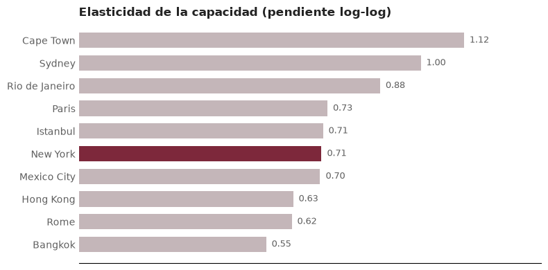
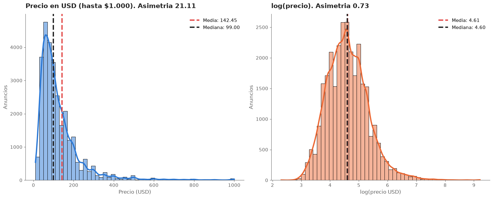
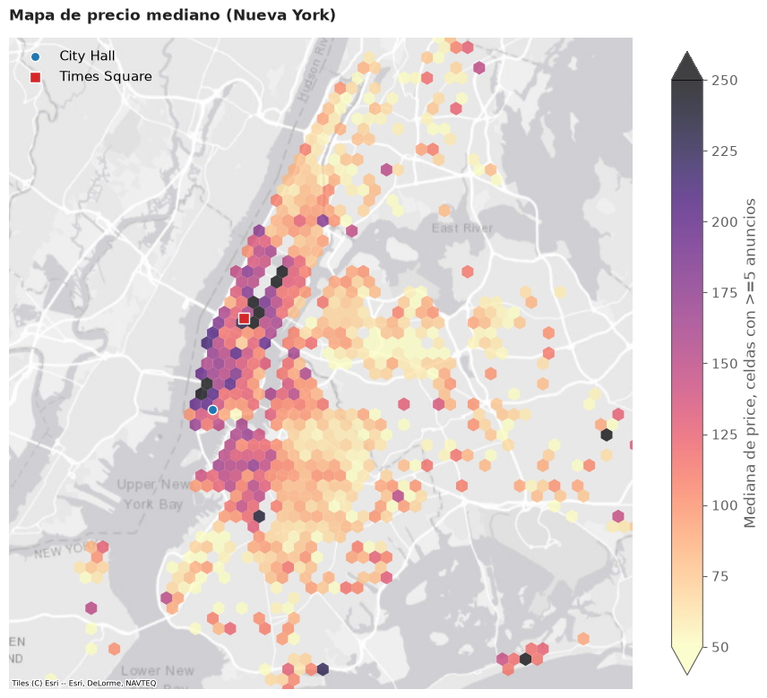
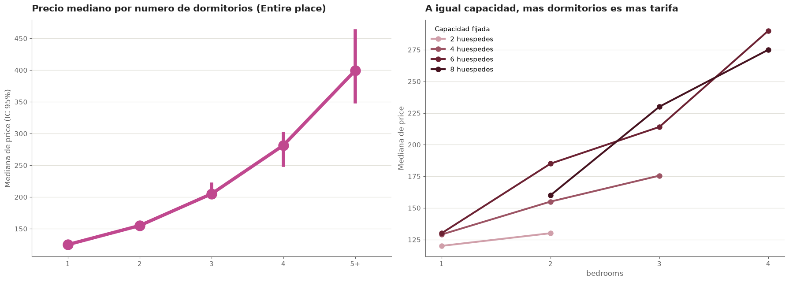
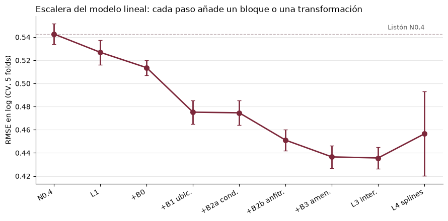
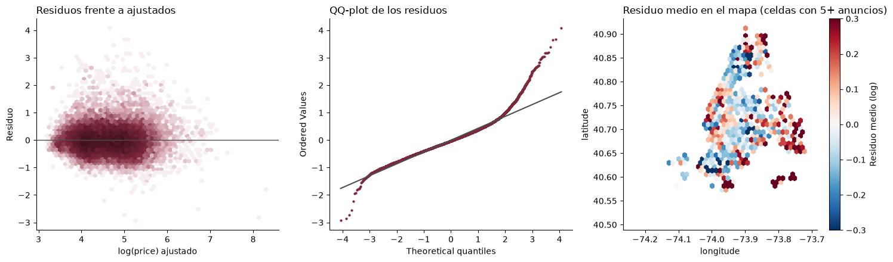
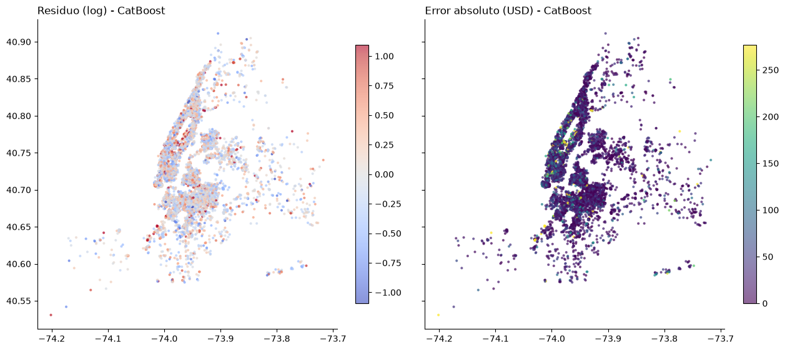
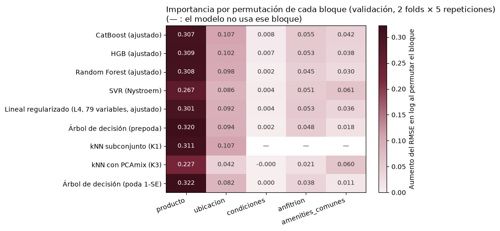
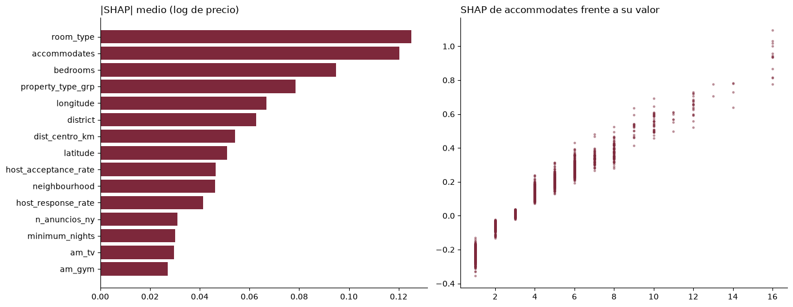
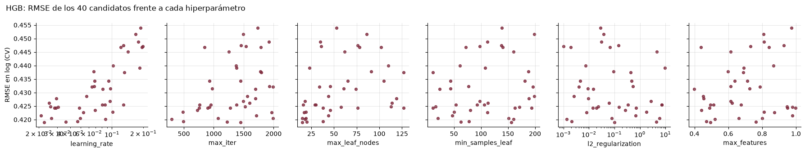

# Documentación para analistas

**Predicción del precio por noche de un anuncio nuevo de Airbnb en Nueva York**

> Las cifras proceden de `outputs/`, `models/` y de las conclusiones de los
> notebooks; el repositorio completo acompaña a esta memoria como apéndice y permite reproducir cada resultado.
> Salvo que se indique otra cosa: **CV** = validación cruzada de 5 folds sobre el train, agrupada por anfitrión;
> **test** = 7.384 anuncios apartados antes de cualquier análisis del precio y evaluados una sola vez;
> **RMSE** = raíz del error cuadrático medio sobre `log(price)`.

---

## 1. Objetivos del proyecto

### Situación

Airbnb publica para cada anuncio su precio por noche junto con las características del alojamiento, su ubicación y
el perfil del anfitrión. El conjunto de datos aportado (`listings.csv`, 279.712 anuncios de 10 ciudades, y
`reviews.csv`, con datos hasta 2021) recoge esa información, pero no dice
cuánto *debería* cobrar un anuncio nuevo. Un anfitrión que publica por primera vez fija el precio mirando anuncios
parecidos, sin una referencia objetiva.

### Complicación

El precio de un alojamiento depende de muchas cosas a la vez y de forma poco intuitiva. Durante el análisis
exploratorio se comprobó repetidas veces que **la lectura marginal engaña**: la densidad de huéspedes por dormitorio,
el volumen de reseñas o la estancia mínima cambiaban de signo al comparar dentro del mismo tipo de producto. Una
regla sencilla ("un piso entero para cuatro cuesta X") deja errores grandes, y combinar a mano decenas de atributos
no es viable. Es un problema natural para un modelo supervisado que aprenda esas relaciones a partir de los datos.

### Objetivos

1. **Predecir el precio por noche de un anuncio nuevo** en Nueva York con la información disponible en el momento
   de publicarlo (alojamiento, ubicación y perfil del anfitrión), sin usar nada que solo exista después (reseñas).
2. **Acompañar la predicción de un rango** que contenga el precio real en el 80% de los casos.
3. **Explicar qué determina el precio** y dónde es fiable el modelo y dónde no.

### Cambio de objetivos durante el proyecto: de 10 ciudades a Nueva York

El planteamiento inicial era un estudio del mercado internacional. El análisis de `0-INTRODUCCION` lo descartó por dos
razones, ambas medidas en los datos:

- **No hay un objetivo común.** `price` viene en la moneda local de cada ciudad y el fichero no lo documenta: la
  mediana va de 65 (Roma) a 1.100 (Bangkok), ×17. Al aplicar un tipo de cambio aproximado, la dispersión baja a ×3,
  lo que confirma que la diferencia era la divisa. Convertir exigiría el tipo de cambio de la fecha del volcado, que
  no está, y no resolvería las diferencias de poder adquisitivo.
- **El precio no se comporta igual en todas las ciudades**, incluso con medidas que la moneda no afecta (Figura 1):
  doblar la capacidad multiplica el precio por 1,5 en Bangkok y por 2,2 en Ciudad del Cabo, y una habitación privada
  cuesta el 84% de un piso entero en Bangkok frente al 39% en Sídney. Un modelo único necesitaría interacciones de la
  ciudad con casi todo.



*Figura 1. La capacidad no vale lo mismo en cada ciudad: la pendiente log-log entre capacidad y precio se duplica de
Bangkok a Ciudad del Cabo. Fuente: 0-INTRODUCCION, §3.*

Se eligió **Nueva York** porque es la única ciudad con `district` completo (en las otras nueve la columna está vacía),
la que sitúa cada anuncio con más detalle (220 barrios), tiene
muestra de sobra (37.012 anuncios, la segunda tras París) y su precio está en una sola divisa.

### Formulación técnica

Regresión supervisada sobre **`log(price)`**. El logaritmo reduce la asimetría del precio de 21,1 a 0,7 (Figura 2) y
convierte el error en relativo, que es lo que importa al recomendar un precio. Al deshacer la transformación,
`exp(ŷ)` estima la **mediana** del precio de un anuncio con esas características, no su media. La métrica principal
de comparación es el RMSE en log; para el negocio se reporta además el error absoluto en dólares (MAE y mediana del
error).



*Figura 2. El precio tiene una cola derecha muy larga; en logaritmo la distribución es casi simétrica. Fuente:
2-ANALISIS, §2.1.*

Se definieron dos escenarios de uso: **B (principal)**, un anuncio nuevo de cualquier anfitrión, con su perfil
(antigüedad, tasas de respuesta, cartera…); y **A (contraste)**, un anfitrión nuevo sin historial, que prescinde de ese
bloque. La diferencia entre ambos mide cuánto vale conocer al anfitrión.


---

## 2. Principales logros obtenidos

- **Un modelo que predice el precio de un anuncio nuevo con un error típico de 21$.** El modelo de referencia, CatBoost, obtiene en el test un RMSE en log de **0,429** (IC 95% 0,408-0,451) y una mediana del error de **21,1$** (Tabla 2). Todas las métricas quedan dentro de ±2 desviaciones típicas de la CV: no hay señal de sobreajuste a la validación.
- **Una mejora clara sobre las referencias razonables.** En CV, el modelo reduce el RMSE un **22%** frente a la mejor regla ingenua y la mediana del error de 29$ a 21,5$.
- **Un rango de precio calibrado.** El intervalo 10%-90%, calibrado con regresión cuantílica conformal (CQR), cubre el **77,9%** de los precios del test (IC 95% 72,3-81,5), con el 80% nominal dentro del intervalo de confianza.
- **Un diagnóstico honesto de dónde falla.** El error se concentra en los anuncios caros: en el 20% más caro la cobertura del rango baja al 55,9% y los 20 peores errores son pisos de lujo infravalorados.
- **Una lectura clara de qué determina el precio:** el producto (tipo, capacidad, dormitorios) domina, seguido de la ubicación; el perfil del anfitrión y las amenities aportan algo parecido entre sí, y las condiciones de reserva casi nada.
- **Un proceso reproducible y sin fuga de información:** partición fija agrupada por anfitrión y un test abierto una sola vez tras comprobar su huella MD5.


---

## 3. Aproximación elegida

### 3.1 El problema y la idea que ordena todo el proceso

El problema es de **regresión supervisada** sobre `log(price)` con datos tabulares mixtos (numéricos, categóricos de
alta cardinalidad y 56 binarias de amenities). La decisión de diseño que condiciona el resto es una **barrera física
contra la fuga de información**: el test se separa antes de mirar el precio, los notebooks de análisis y modelado
solo leen el train, y el test solo lo abre el notebook del modelo final.

```
listings.csv ─► 0-INTRODUCCION (alcance: Nueva York)
             ─► 1-EXPLORACION (calidad de datos sin mirar el precio)
             ─► 2-ANALISIS (EDA del precio, solo train)
             ─► 3-MODELADO (registro de experimentos)
             ─► 4-MODELO_FINAL (dos finalistas)
```

### 3.2 Extracción, transformación y carga

- **Extracción:** filtrado de Nueva York (37.012 anuncios y 847.727 reseñas, enlazadas por `listing_id`).
- **Calidad (sin mirar el precio):** sin duplicados de extracción; 11 anuncios idénticos salvo el identificador
  (alojamientos distintos de un mismo edificio, se conservan); 13 anuncios con capacidad 0 y 15 con precio nulo o 0, eliminados (un precio nulo no es una observacións).
- **Precios de bloqueo:** se excluyen precios ≥ 9.999$ y habitaciones a más de 1.000$ la noche (48 anuncios del train y 14 del test), con umbrales fijados en el train. Se descartó recortar por el percentil 99 (850$) porque eliminaba el 18,8% de los pisos para 9 o más huéspedes, es decir, el lujo legítimo que el modelo debe aprender. Resultado: **36.922 anuncios válidos, 29.538 en train y 7.384 en test**.
- **Transformación:** toda la preparación está en `PreparadorListings` (`scripts/preparacion_datos.py`), con
  `fit`/`transform` ajustado **solo con el train** y congelado en `data/modelado/preparador.json`. Aprende la
  ventana de amenities, los tipos de propiedad frecuentes y las medianas para imputar dormitorios.
- **Variables construidas:** `es_estudio` (el 70% de los pisos enteros sin dato de dormitorios lleva *studio* en el título, y cuestan un 12% menos que un piso de un dormitorio de igual capacidad, por eso al imputar ``bedrooms`` a 1 añadimos esta variable); `host_ambito` (dónde vive el anfitrión, normalizado desde texto libre); `dist_centro_km` `n_anuncios_ny` (tamaño de la cartera del anfitrion); `reputacion_cartera` (puntuación media de los *otros* anuncios del anfitrión, disponible al publicar); y 56 amenities binarias con prevalencia entre el 3,5% y el 97% (criterio ciego al precio), las que aparecen en mas del 97% y menos del 3.5% no aportan informacion al estar presentes (o no presentes) en la mayoria de anuncios.

### 3.3 Partición y validación

- **Agrupada por anfitrión.** El 38,1% de los anuncios pertenece a anfitriones con varios pisos y el 23,7% tiene un
  "gemelo" en su cartera (mismo tipo, capacidad, dormitorios y barrio). Partir por filas dejaría gemelos a ambos
  lados y el error saldría optimista; es una fuga reconocida en la literatura sobre datos jerárquicos (Roberts et al.,
  2017; Kapoor y Narayanan, 2023).
- **Estratificada por `room_type` × `district`.** En 50 particiones simuladas, sin estratificar el test llegaba a tener el doble de habitaciones de hotel de las esperadas; con el estrato combinado la desviación queda por debajo
  de 0,1 puntos en las 18 celdas.
- **Test del 20%, semilla 42, guardado con huella MD5** en `data/particion/`. El script se niega a sobrescribirlo.
- **CV de 5 folds × 3 repeticiones** con el mismo agrupamiento y estrato, guardada en `outputs/folds_cv.csv`. Las
  15 estimaciones se usan para seleccionar variables; la primera repetición (5 folds), para comparar modelos y ajustar
  hiperparámetros. Al compartir folds, todas las comparaciones son **pareadas**.

### 3.4 Protocolo de experimentación

- **Escalera de complejidad:** referencias ingenuas → lineal → kNN y árbol → Random Forest y HGB → SVR y CatBoost.
  Cada peldaño responde a una pregunta (cuánto aporta el producto, la ubicación, la no linealidad).
- **Reglas de decisión fijadas antes de mirar los resultados**, recogidas en la bitácora con fecha: la regla de selección de variables, la de elección del modelo final (menor RMSE medio de CV en el escenario B) y el margen de equivalencia práctica (±0,005 de RMSE en log).
- **Registro de todos los experimentos**, también los que salieron mal: más de 500 experimentos en `outputs/experimentos.csv`, una fila por fold, con variables, hiperparámetros y tiempos.
- **Todo lo que aprende de los datos va dentro del `Pipeline`** de cada fold (codificaciones, imputación, escalado).


### 3.5 Restricciones encontradas

- **Sin información de calidad o lujo** más allá de las amenities: no hay superficie, fotos ni descripción.
- **Normativa local:** la *Multiple Dwelling Law* de Nueva York explica que el 64% de los anuncios exija 30 noches mínimas; no altera el precio por noche, pero condiciona el tipo de mercado.
- **Cómputo:** la búsqueda de hiperparámetros de CatBoost se recortó de 40 a 10 candidatos para que el plan cupiera en el calendario (se declara que se decidió viendo resultados parciales; el óptimo ya era plano).
- **Sin datasets externos:** no se han usado otros datos para enriquecer los del cliente. `reviews.csv` solo se usó para fechar la instantánea y caracterizar la actividad, no como variable.

### 3.6 Tecnologías

- **Lenguaje:** Python 3.13.
- **Datos:** pandas 3.0 y pyarrow.
- **Modelado:** scikit-learn 1.9 (pipelines, `StratifiedGroupKFold`, HGB, Random Forest, kNN, SVR con Nystroem,
  `TargetEncoder`) y CatBoost 1.2 (incluido SHAP nativo).
- **Estadística:** statsmodels (OLS con errores agrupados).
- **Datos mixtos:** prince (FAMD) y una implementación propia de PCAmix.
- **Visualización:** matplotlib y seaborn.
- **Cómputo:** Google Colab con GPU, para repetir la búsqueda de CatBoost como prueba de velocidad.

---

## 4. Descripción del modelo

| | |
|---|---|
| **Metodología** | Predecir la mediana del precio por noche de cada anuncio a partir de sus características al publicarse; aprender la relación con anuncios existentes y medirla en anuncios de anfitriones que el modelo no ha visto |
| **Modelo** | *Gradient boosting* con árboles simétricos (CatBoost), con un intervalo del 80% formado por dos modelos cuantílicos calibrados con CQR. Alternativa equivalente: HGB de scikit-learn |
| **Variable dependiente** | `log(price)`, precio por noche en USD |
| **Variables explicativas** | 79 que diferenciamos en cinco bloques: producto, ubicación, condiciones de reserva, perfil del anfitrión y amenities |
| **Frente a la referencia** | Mejora un 22% en RMSE a la mejor regla ingenua (mediana por tipo × capacidad) y un 4% al mejor modelo lineal |
| **Conocer al anfitrión** | Sin su perfil (escenario A), el RMSE sube un 3,7% (HGB) y un 4,0% (lineal) |


---

## 5. Resultados principales soportados por datos

### 5.1 Lo que dicen los datos antes de modelar (EDA sobre el train)

El análisis exploratorio se hizo **solo con el train** y con estadísticos robustos (medianas, Kruskal-Wallis,
Mann-Whitney con corrección de Holm, Spearman), ocultando celdas con menos de 30 anuncios.

- **El tipo de alojamiento es lo que más separa el precio** (ε² = 0,41 en Kruskal-Wallis): pisos enteros 140$ de
  mediana, habitaciones privadas 60$.
- **La ubicación opera en tres niveles:** distrito (ε² = 0,09; Manhattan 120$ frente a Bronx 67$), barrio
  (η² = 0,19) y distancia al centro, con un gradiente que persiste dentro de cada distrito (Figura 3).
- **Hay economía de escala:** el precio por plaza cae un 50% de 1 a 7 o más huéspedes, y un huésped adicional vale
  36$ en Manhattan frente a 20$ en el Bronx.
- **La lectura marginal engaña** (Figura 4): la densidad de huéspedes por dormitorio correlaciona positivamente con
  el precio (ρ = +0,38), pero a igual capacidad más dormitorios es más precio en todos los tramos.
- **Señales menores:** la reserva inmediata se asocia a un precio un 7% más bajo a igual producto y zona; los
  anuncios sin tiempo de respuesta (inactivos, la mitad del train) piden un 18% más; los superhosts no cobran más, suponemos que tienen una mayor rotacion.



*Figura 3. El precio se concentra en el sur y centro de Manhattan y cae hacia la periferia. Fuente: 2-ANALISIS, §7.*



*Figura 4. A igual capacidad, cada dormitorio adicional sube el precio: la correlación marginal positiva de la
densidad era un efecto de la capacidad. Fuente: 2-ANALISIS, §4.2.*

### 5.2 La escalera de modelos

**Referencias ingenuas.** Predecir siempre la mediana desde el global por agrupaciones. Captura casi todo el comportamiento aditivo.

**Modelo lineal.** La escalera aditiva (Figura 5) muestra cuánto aporta cada bloque: producto completo 0,514 →+ ubicación 0,475 (el mayor salto) → + condiciones 0,475 (nada) → + anfitrión 0,451 → + amenities 0,437. Las
interacciones apenas aportan y los *splines* sin penalizar hacen la OLS inestable (rango incompleto; predicciones
absurdas fuera del rango del train). La regularización no mejora la precisión (Ridge, Lasso y ElasticNet empatan con
n ≫ p), pero estabiliza el diseño. **El lineal elegido (Lasso, 79 variables) llega a 0,434**: un modelo aditivo ya
explica el 63% de la varianza del log-precio.



*Figura 5. La ubicación y el perfil del anfitrión son los dos grandes saltos del modelo aditivo después del producto;
las condiciones de reserva no aportan. Fuente: 3-MODELADO, §5.*

**Coeficientes hedónicos.** Una OLS interpretable, con errores estándar agrupados por anfitrión, permite leer
asociaciones condicionadas en porcentaje del precio: una habitación privada cuesta un 40% menos que un piso entero
comparable; cada dormitorio suma un 16% y cada huésped un 9%.  Agrupar los errores por anfitrión los hace 1,5 veces mayores y evita declarar significativossiete efectos que no lo son. Entre las amenities, las de edificio o vivienda de gama alta (gimnasio,chimenea) se asocian a primas de alrededor del 20%, y las de cocina básica y estancia larga, a precios algo menores.


Los diagnósticos de la OLS (Figura 7) muestran heterocedasticidad, una cola derecha pesada (anuncios mucho más caros
de lo predicho: el lujo que las variables no ven) y manchas espaciales en los residuos. Es el hueco que deben cubrir
los modelos no lineales con las coordenadas.



*Figura 7. La OLS deja una cola de anuncios caros sin explicar y estructura espacial en los residuos. Fuente:
3-MODELADO, §5.3.*

**Modelos no lineales y ensembles.** La Tabla 1 resume la comparación con los mismos 5 folds.

*Tabla 1. Comparación de modelos en CV (5 folds, escenario B). Fuente: `outputs/experimentos.csv`.*

| Modelo | Variables | RMSE log (media ± sd) | R² log | Mediana error ($) |
|---|---|---|---|---|
| **CatBoost ajustado** | 79 | **0,416 ± 0,009** | 0,657 | 21,5 |
| HGB ajustado | 79 | 0,419 ± 0,010 | 0,653 | 21,5 |
| Random Forest ajustado | 79 | 0,428 ± 0,012 | 0,638 | 22,0 |
| SVR (kernel Nystroem) | 79 | 0,432 ± 0,012 | 0,631 | 22,7 |
| Lineal (Lasso) | 79 | 0,434 ± 0,009 | 0,627 | 22,6 |
| Árbol de decisión (prepoda) | 79 | 0,472 ± 0,014 | 0,560 | 23,8 |
| kNN, 5 variables (K1) | 5 | 0,474 ± 0,012 | 0,556 | 24,8 |
| kNN con PCAmix (K3) | 65 | 0,481 ± 0,012 | 0,543 | 24,9 |
| Mediana por tipo × capacidad | 2 | 0,535 ± 0,009 | 0,434 | 29,0 |
| Mediana por barrio × tipo | 3 | 0,543 ± 0,009 | 0,418 | 26,0 |
| Mediana global | 0 | 0,711 ± 0,009 | 0,000 | 43,8 |


La lectura de la escalera es que **la mayor parte de la señal ya la recoge el modelo aditivo**: el lineal queda a un
4,3% del mejor. Lo que añaden los *boosting* son no linealidades e interacciones (la ubicación fina, la cola de
capacidad), y eso basta para ser los mejores con claridad.

### 5.3 Elección del modelo final

La regla fijada es elegir el **menor RMSE medio de CV en el escenario B**: **CatBoost** (0,4162 frente a 0,4191 de HGB). La ventaja es consistente (CatBoost gana en los 5 folds) pero pequeña:
Δ = 0,0029, menos que un error estándar. Un **TOST pareado** con margen ±0,005 (fijado antes de calcular) concluye que
ambos son **equivalentes en la práctica** (IC 90% de la diferencia [−0,0042; −0,0016], p = 0,012). Por eso se
presentan dos finalistas: **CatBoost como modelo de referencia y el que se entrega**, y **HGB como alternativa
equivalente y unas 20 veces más rápida** de entrenar.

### 5.4 Resultados en el test

El test se abrió una sola vez, tras comprobar su MD5, para los dos finalistas a la vez. Los intervalos de confianza se
obtienen por *bootstrap* remuestreando **anfitriones** (2.000 réplicas).

*Tabla 2. Métricas en el test (7.384 anuncios) frente a la CV. Fuente: `outputs/resultados_test_*.csv`.*

| Métrica | CatBoost test (IC 95%) | CatBoost CV | HGB test (IC 95%) | HGB CV |
|---|---|---|---|---|
| RMSE en log | 0,429 (0,408-0,451) | 0,416 | 0,424 (0,407-0,442) | 0,419 |
| R² en log | 0,636 (0,601-0,672) | 0,657 | 0,645 (0,608-0,680) | 0,653 |
| MAE ($) | 49,9 (44,5-56,3) | 47,6 | 49,4 (44,7-55,0) | 48,1 |
| Mediana del error ($) | 21,1 (19,1-24,1) | 21,5 | 21,1 (19,4-24,0) | 21,5 |


- **Coherente con la CV:** el test sale algo peor (0,013 en CatBoost, 0,005 en HGB), dentro de la variabilidad del
  muestreo.
- **En el test el orden se invierte** (HGB 0,424 frente a CatBoost 0,429), pero la diferencia pareada no es concluyente: −0,0053 con IC 95% [−0,017; +0,003], que contiene el cero.
- **Error típico frente a error medio:** la mediana del error (21$) es menos de la mitad del MAE (50$): pocos anuncios caros con errores grandes elevan la media.

### 5.5 El rango de precio

Los cuantiles 0,1 y 0,9 sin calibrar cubrían solo el 72% en la calibración: los cuantiles extremos quedan demasiado cerca del centro en datos nuevos. La **regresión cuantílica conformal** (CQR) los ensancha lo justo.

- **Cobertura en el test:** 77,9% (CatBoost, IC 72,3-81,5) y 79,0% (HGB). Anchura mediana: 94$.
- **Por distrito:** Manhattan se queda corto (73,7%) y tiene los intervalos más anchos (125$), es la ciudad con mayor lujo es normal que su rango sea el mayor; Brooklyn y Queens cubren el 81-83%.
- **Por quintil de precio:** 84-88% en los quintiles centrales, **55,9% en el más caro**. El quintil se define con el precio real, lo que favorece mecánicamente peor cobertura en los extremos.

### 5.6 Dónde se equivoca el modelo

*Tabla 3. Error absoluto medio de CatBoost en el test por segmento. Fuente: 4-MODELO_FINAL, §6.*

| Segmento | MAE ($) |
|---|---|
| Habitaciones privadas | 25 |
| Pisos enteros | 70 |
| Manhattan | 66 |
| Pisos para 7 o más huéspedes | 172 |
| Habitaciones de hotel (57 anuncios) | 175 |
| Quintil de precio más caro | 154 |

- **Los 20 peores errores son pisos enteros de más de 1.490$ y que han infravalorados**, prácticamente los mismos en los dos modelos. El peor es un anuncio de 6.500$ que se predice en 460$: para el modelo es un piso de 7 huéspedes y 3 dormitorios como cualquier otro, a parte de esos atributos no se detecta el lujo del piso.
- **Sensibilidad a la cola:** sin los precios por encima del percentil 99 del train (794$, 81 anuncios), el RMSE baja a 0,395 y el MAE a 39,1$. La cola explica unos 11$ del MAE.
- **Sin sesgo espacial claro** (Figura 8): los residuos grandes están repartidos por Manhattan y Brooklyn, donde hay más anuncios y precios más altos.



*Figura 8. Los errores de CatBoost no forman manchas geográficas: la ubicación está bien capturada. Fuente:
4-MODELO_FINAL, §6.1.*

---

## 6. Detalles del modelo

### 6.1 Variables y su poder predictivo

Las 79 candidatas se organizan en cinco bloques:

| Bloque | Variables | Ejemplos |
|---|---|---|
| Producto | 5 | `room_type`, `property_type_grp`, `accommodates`, `bedrooms`, `es_estudio` |
| Ubicación | 5 | `latitude`, `longitude`, `dist_centro_km`, `district`, `neighbourhood` |
| Condiciones de reserva | 3 | `minimum_nights`, `estancia_min_30`, `instant_bookable` |
| Perfil del anfitrión | 10 | antigüedad, cartera, superhost, tasas de respuesta y aceptación, `host_ambito`, `reputacion_cartera` |
| Amenities comunes| 56 | gimnasio, ascensor, lavadora, chimenea, cocina… |

**Selección de variables.** Se aplicó una regla fijada antes de ejecutar: una variable o bloque entra si, sobre
las 15 estimaciones , Δ = RMSE sin ella − RMSE con ella es positivo en al menos 12 y el Δ medio supera su
desviación típica. Es una heurística declarada como tal (los 15 Δ no son independientes); el **p de Nadeau-Bengio** se
muestra como dato informativo.

La selección solo decide las variables del lineal y del kNN, a los que una variable inútil sí perjudica. 

**Importancia por permutación.** Se mide en validación (no en train) y por bloques, porque las variables de ubicación
están correlacionadas entre sí y su importancia individual se reparte. El orden es el mismo en todas las familias de
modelos (Figura 9): producto ≫ ubicación > anfitrión ≈ amenities ≫ condiciones de reserva. En el test, con
CatBoost: producto 0,29, ubicación 0,11, anfitrión y amenities ≈ 0,05, condiciones 0,004.



*Figura 9. Todas las familias usan la misma información y en el mismo orden: el producto domina. Fuente:
3-MODELADO, §12.*

Variable a variable (CatBoost, validación), encabezan `accommodates` (0,067), `room_type` (0,061), `bedrooms`
(0,037), las coordenadas (0,021) y `property_type_grp` (0,020). La importancia por impureza del árbol se descartó
porque premia variables continuas con muchos cortes que no generalizan (`n_anuncios_ny` era la 4.ª por impureza y la
9.ª por permutación).

**SHAP.** El SHAP nativo de CatBoost (Figura 10) confirma el orden: `room_type` (0,125) y
`accommodates` (0,120) son las variables que más contribuyen. La contribución de la capacidad crece casi linealmente,
de −0,25 con un huésped a cerca de +1,0 con dieciséis.



*Figura 10. Tipo de alojamiento y capacidad son las variables que más contribuyen a cada predicción. Fuente:
4-MODELO_FINAL, §7.1.*

Permutación y SHAP describen **cómo usa el modelo** cada variable, no un efecto causal sobre el precio.

### 6.2 Hiperparámetros

Búsqueda aleatoria sobre los 5 folds de la primera repetición, con cada candidato registrado fold a fold:

| Modelo | Candidatos | Configuración elegida |
|---|---|---|
| CatBoost | 10 | `depth` 7, `learning_rate` 0,083, `l2_leaf_reg` 10,8, hasta 3.000 iteraciones con parada temprana a 65 sobre un 10% del train del fold; categóricas nativas con *ordered target statistics* |
| HGB | 40 | `learning_rate` 0,0225, `max_iter` 1.448, `max_leaf_nodes` 15, `min_samples_leaf` 156, `l2_regularization` 0,10, `max_features` 0,5; barrio con `TargetEncoder` |

**El óptimo es plano** en los dos *boosting* (Figura 11): en HGB, los seis mejores candidatos están entre 0,4191 y
0,4205 con configuraciones muy distintas; lo que comparten es árboles pequeños y regularizados. En CatBoost, las ocho
mejores configuraciones caben en 0,002, menos que la desviación entre folds. Por eso el RMSE de CV del ganador es algo
optimista (se elige sobre los mismos folds), y por eso existe el test.



*Figura 11. Solo la tasa de aprendizaje muestra una tendencia clara; el resto de hiperparámetros apenas mueve el
error. Fuente: 3-MODELADO, §9.3.*

**Codificación del barrio.** Con 220 barrios (la mitad con menos de 30 anuncios) se compararon tres opciones en HGB:
`TargetEncoder` (0,4233), categórica nativa (0,4253) y sin barrio (0,4263). Ninguna diferencia pasa la regla: con
coordenadas, distancia y distrito, el barrio apenas añade información. CatBoost aporta una cuarta vía, *ordered target
statistics*, que evita que el precio de un anuncio entre en su propia codificación.

### 6.3 Eficiencia de ejecución

- **Reentrenamiento final con todo el train:** CatBoost unos **220 s**, HGB unos **10 s** (≈ 20 veces más rápido).
- **Por fold en CV:** HGB ajustado unos 7-8 s; el ganador de HGB podía sustituirse por un candidato que tarda 1,3 s
  con solo un 0,1% más de error. Los tiempos de CatBoost en CV se midieron con folds en paralelo y no son comparables.
- **Predicción:** inmediata en los dos).
- **Coste del plan completo:** del orden de 5 horas de cómputo tras recortar la búsqueda de CatBoost y la ablación. Los resultados se guardan en el registro y no se recalculan al reejecutar los notebooks.
- **GPU:** CatBoost en Colab acelera la búsqueda, pero no reproduce exactamente la CPU (otra discretización); el resultado oficial es el de CPU, expiro la sesion de Google Collab.

### 6.4 Ventajas e inconvenientes

| | CatBoost (referencia) | HGB (alternativa) |
|---|---|---|
| **Ventajas** | Menor RMSE de CV, gana en los 5 folds; categóricas nativas sin fuga de la codificación; SHAP nativo | 20 veces más rápido; incluido en scikit-learn (sin dependencia adicional); mismo rendimiento en test |
| **Inconvenientes** | Más lento; se ajusta más al train (0,318 frente a 0,416 de CV) sin generalizar mejor en test | Barrio con `TargetEncoder`, cuyo *cross-fitting* interno es por filas y no por anfitrión (efecto pequeño, se declara) |

### 6.5 Limitaciones que se declaran


- **La CQR usa un solo conjunto de calibración** (fold 0) y la intercambiabilidad solo se cumple de forma
  aproximada (anuncios correlacionados por anfitrión).
- **La regla de precios de bloqueo se aplicó también al test;** en producción el precio no se conoce de antemano, así
  que el modelo no está pensado para tarifas de bloqueo.
- **Sesgo de selección por reseñas:** los pisos enteros sin reseñas son un 11% más caros; las reseñas quedaron fuera
  del modelo, pero cualquier análisis basado en ellas hereda ese sesgo.
- **Los RMSE de CV de los modelos ajustados son algo optimistas** (elegidos sobre los mismos folds); el test lo acota.

---

## 7. Recomendaciones

### Para la organización

- **Usar el modelo como sugerencia de precio al publicar**, mostrando la mediana y el rango, no como precio automático. El valor está en dar al anfitrión nuevo una referencia mejor que "anuncios parecidos".
- **Señalar los anuncios grandes o de gama alta** (pisos para 7 o más huéspedes, predicciones altas, Manhattan) para revisión humana: ahí el rango cubre solo la mitad de las veces.
- **Si el coste de cómputo pesa, desplegar HGB**: rendimiento equivalente.

### Implementación técnica

- **Servicio de predicción:** la cadena completa ya está empaquetada (anuncio en bruto → `PreparadorListings` →
  modelo → `exp(ŷ)` e intervalo CQR) en `predecir_precio` (`scripts/func_final.py`). Requiere pasar la cartera
  completa del anfitrión en Nueva York, porque `n_anuncios_ny` y `reputacion_cartera` se calculan sobre las filas
  recibidas; en producción conviene calcularlas desde la base de datos de anfitriones.
- **Versiones fijadas:** los modelos `joblib` solo cargan con las mismas versiones de scikit-learn y CatBoost
  (anotadas en `models/ficha_modelo_*.json`). Conviene servirlos en un entorno congelado.
- **Reentrenamiento periódico** con instantáneas nuevas: el modelo se ajustó con una única foto en plena pandemia.
  `PreparadorListings` permite preparar instantáneas nuevas con los parámetros aprendidos o reajustarse.
- **Monitorización:** cobertura del intervalo por segmento (alerta si baja del 75%), deriva de las variables de
  producto y ubicación, y proporción de anuncios en el segmento de lujo.

### Mejoras de datos y de modelo

- **Capturar información que distinga el lujo:** superficie, fotos, texto del título y la descripción, calidad del
  edificio. Es la vía con más margen: el error se concentra en anuncios que las variables actuales no separan de un
  piso simplemente grande.
- **Tomar el perfil del anfitrión en el momento de publicar**, para que el escenario B no use información de 2021.
- **Líneas futuras:** variables del título, reseñas como complemento en un escenario de anuncios existentes, otra
  ventana temporal y una validación de transferencia a otra ciudad con precio en USD.
