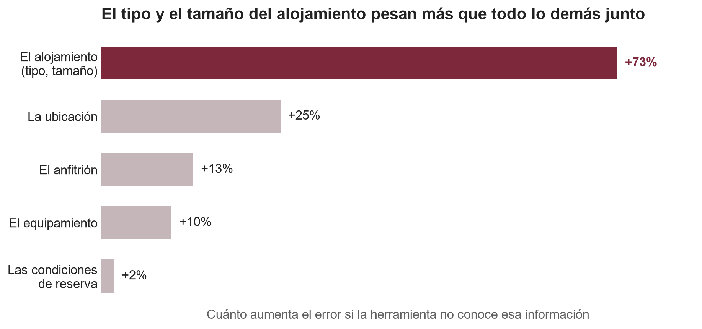
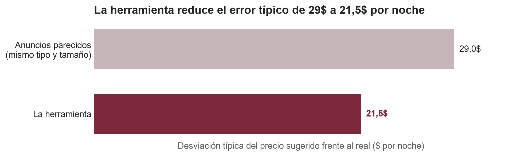
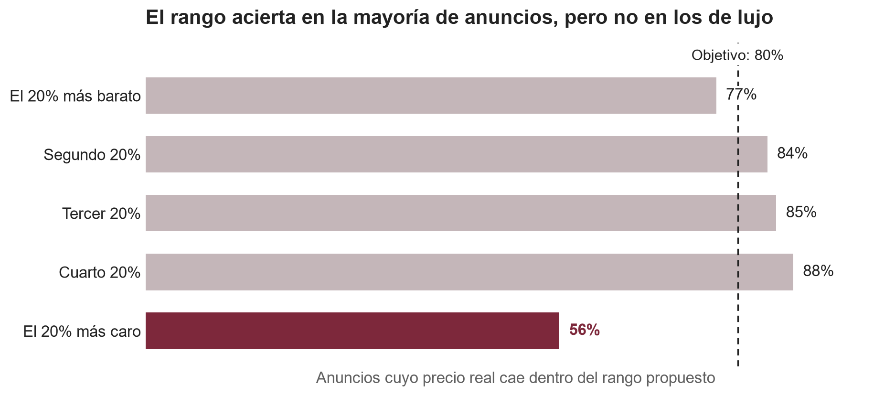

# Documentación para el sponsor

**Un precio de partida para cada anuncio nuevo de Airbnb en Nueva York**

---

## Resumen ejecutivo

- **Qué se ha construido:** una herramienta que, a partir de lo que un anfitrión sabe al publicar (cómo es el
  alojamiento, dónde está y quién lo ofrece), propone un **precio por noche** y un **rango razonable** alrededor.
- **Cuánto acierta:** en un anuncio típico, el precio sugerido se desvía **unos 21$** del precio real. Frente a
  fijarse en anuncios del mismo tipo y tamaño, que es lo que haría un anfitrión hoy, el error típico baja de 29$ a
  21$.
- **El rango es fiable:** el precio real cae dentro del rango propuesto en **casi 8 de cada 10 anuncios**, como se
  buscaba.
- **Qué mueve el precio:** sobre todo el tipo de alojamiento y su tamaño; después, la ubicación exacta. El perfil del
  anfitrión y el equipamiento pesan menos, y las condiciones de reserva, casi nada.
- **Dónde no fiarse:** en los alojamientos de lujo. Con la información de un anuncio, un piso de lujo y uno
  simplemente grande se parecen demasiado, y el modelo tiende a quedarse corto.
- **Recomendación:** adoptar la herramienta como **sugerencia de precio al publicar**, con el rango visible y revisión
  humana en los anuncios grandes o de gama alta.

---

## 1. Objetivos del proyecto

**Situación.** Quien publica por primera vez un alojamiento en Airbnb tiene que decidir cuánto cobrar por noche, y lo
habitual es mirar anuncios parecidos de la zona. Es una referencia imprecisa: dos pisos que parecen iguales pueden
tener precios muy distintos según la calle, el edificio o el equipamiento.

**Complicación.** El precio depende de muchas cosas a la vez, y no siempre de la forma que parece a simple vista. Por
ejemplo, a primera vista los pisos con más huéspedes por dormitorio parecen más caros, pero es solo porque son pisos
más grandes: a igual capacidad, más dormitorios significa más precio. Combinar decenas de factores a mano no es
posible; un modelo que aprenda de miles de anuncios sí puede hacerlo.

**Objetivos.**

1. Proponer un **precio por noche** para un anuncio nuevo con la información disponible al publicarlo.
2. Acompañarlo de un **rango** que contenga el precio real en 8 de cada 10 casos.
3. Explicar **qué determina el precio** y en qué tipo de anuncios se puede confiar en la propuesta.

**Un cambio de alcance.** El encargo partía de datos de diez ciudades. Al analizarlos se vio que el precio de cada
ciudad venía en su moneda local sin indicarlo, y que el mercado funciona de forma distinta en cada una: en Bangkok una
habitación privada cuesta casi lo mismo que un piso entero, y en Sídney menos de la mitad. Mezclar diez mercados en una
sola herramienta habría dado peores resultados en todos. Se decidió centrar el trabajo en **Nueva York**, que tiene el
precio en dólares, la información de ubicación más detallada del conjunto y casi 37.000 anuncios.

---

## 2. Principales logros obtenidos

- **Un precio sugerido con un error típico de unos 21$ por noche**, comprobado en anuncios y anfitriones que la
  herramienta no había visto nunca.
- **Un 22% más preciso que la regla de "anuncios parecidos"** del mismo tipo y tamaño.
- **Un rango que cumple lo prometido** en el conjunto del mercado: el precio real cae dentro en casi 8 de cada 10
  anuncios.
- **Un mapa claro de qué mueve el precio**, útil por sí mismo para orientar a los anfitriones.
- **Un diagnóstico honesto de sus límites:** se sabe dónde acierta y dónde no, lo que permite usarla con criterio.

---

## 3. Aproximación elegida

El problema se planteó como **estimar el precio de un anuncio a partir de lo que se sabe al publicarlo**. Esto obliga
a una decisión importante: **no se usan las reseñas ni las puntuaciones**, porque un anuncio nuevo todavía no las
tiene. Una herramienta que dependiera de ellas no serviría para el caso que interesa.

Se utilizó la información de cada anuncio agrupada en cinco tipos:

| Tipo de información | Ejemplos |
|---|---|
| El alojamiento | piso entero o habitación, número de huéspedes, dormitorios, si es un estudio |
| La ubicación | distrito, barrio, distancia al centro, posición exacta |
| Las condiciones de reserva | estancia mínima, reserva inmediata |
| El anfitrión | antigüedad, cuántos anuncios gestiona, rapidez de respuesta |
| El equipamiento | 56 servicios: wifi, cocina, lavadora, gimnasio, ascensor… |

Para que la medida de acierto sea creíble, **una parte de los anuncios se apartó al principio y no se miró hasta el
final**. Además, todos los anuncios de un mismo anfitrión se mantuvieron juntos: muchos gestionan varios pisos casi
idénticos, y si uno se usara para aprender y su gemelo para comprobar, el acierto saldría inflado.

También se excluyeron los precios que no son tarifas reales, como los anuncios a 9.999$ que los anfitriones usan para
bloquear fechas. Se tuvo cuidado de no eliminar el lujo verdadero, que la herramienta debe saber valorar.

---

## 4. Descripción del modelo

| | |
|---|---|
| **Qué hace** | Propone el precio por noche de un anuncio nuevo y un rango en el que el precio real debería caer en 8 de cada 10 casos |
| **Cómo funciona** | Combina cientos de reglas sencillas ("si es un piso entero en Manhattan para cuatro personas…"), cada una corrigiendo los errores de las anteriores. Es un tipo de modelo muy utilizado con datos de este tipo |
| **Con qué información** | La obligatoria al subir un anuncio a airbnb |
| **Sobre qué anuncios** | Casi 37.000 anuncios de Nueva York, con datos de febrero de 2021 |
| **Cómo se comprobó** | Con 7.384 anuncios de anfitriones que la herramienta no había visto nunca |
| **Frente a qué mejora** | Un 22% más precisa que fijar el precio con la mediana de anuncios del mismo tipo y tamaño |

Se probaron nueve familias de modelos, desde reglas muy simples hasta una red neuronal. Los dos mejores obtuvieron
resultados prácticamente idénticos; se entrega el que ganó con el criterio fijado antes de empezar, y el segundo
queda como alternativa más ligera si el coste de cálculo fuera importante.

---

## 5. Resultados principales soportados por datos

### Qué mueve el precio en Nueva York

**Lo primero es el tipo de alojamiento y su tamaño.** Un piso entero cuesta más del doble que una habitación privada
(140$ frente a 60$ por noche en el anuncio típico), y cada huésped o dormitorio adicional sube el precio, aunque
cada plaza extra sale más barata que la anterior.

**Lo segundo es la ubicación, y no solo el distrito.** El precio se concentra en el sur y el centro de Manhattan y cae
hacia la periferia, también dentro de cada distrito (Figura 1). Un anuncio típico cuesta 120$ en Manhattan, 89$ en
Brooklyn y en torno a 70$ en Queens y el Bronx.

*Figura 1. El precio por noche se concentra en el sur y el centro de Manhattan y baja hacia la periferia.*

**El anfitrión y el equipamiento aportan algo parecido entre sí, y menos.** Conocer el perfil del anfitrión mejora la
propuesta, pero la herramienta sigue siendo útil para un anfitrión que publica por primera vez: su error solo aumenta
alrededor de un 4%. En equipamiento, lo que más se asocia a precios altos son servicios propios de edificios y
viviendas de gama alta, como gimnasio o chimenea. **Las condiciones de reserva**, como la estancia mínima, apenas
influyen.

La Figura 2 resume el peso de cada tipo de información: si se le oculta a la herramienta el tipo y el tamaño del
alojamiento, su error sube un 73%; la ubicación, un 25%; el anfitrión y el equipamiento, entre un 10% y un 13%; las
condiciones de reserva, un 2%.

*Figura 2. El tipo y el tamaño del alojamiento pesan más que todo lo demás junto.*

Estas relaciones describen **cómo razona la herramienta**, no causas: que los pisos con gimnasio sean más caros no
significa que instalar un gimnasio suba el precio.

### Cuánto acierta

En un anuncio típico, el precio sugerido se desvía **unos 21$** del real. El error medio es mayor, unos 50$, porque
unos pocos anuncios muy caros acumulan errores grandes (Figura 3).

*Figura 3. Frente a fijarse en anuncios del mismo tipo y tamaño, la herramienta reduce el error típico de 29$ a 21,5$
por noche (validación sobre los datos de entrenamiento).*

### Dónde es fiable y dónde no

**En la mayor parte del mercado, la herramienta es fiable.** En las habitaciones privadas el error medio es de unos
25$, y en los anuncios de precio intermedio el rango acierta en más de 8 de cada 10 casos.

**En el lujo, no.** En el 20% de anuncios más caros, el rango acierta solo en algo más de la mitad de los casos, y los
mayores errores son siempre pisos de lujo a los que la herramienta pone un precio demasiado bajo. El caso más extremo
es un piso de 6.500$ por noche al que propone 460$: para la herramienta es un piso para siete personas como
cualquier otro, porque nada en el anuncio indica que sea excepcional (Figura 4).

*Figura 4. El rango acierta en la mayoría de anuncios, pero no en los de lujo: en el 20% más caro, solo en el 56% de
los casos.*

---

## 6. Detalles del modelo

El detalle técnico (cómo se eligió el modelo, qué otros se probaron, cómo se ajustó y cuánto tarda) está en la
Documentación para analistas, sección 6.

---

## 7. Recomendaciones

**Cómo usarla.** Se recomienda incorporar la herramienta en el momento de publicar un anuncio, como **sugerencia** de
precio con su rango visible, no como precio fijado automáticamente. El anfitrión conserva la decisión; la herramienta
le da un punto de partida mejor que comparar a ojo.

**Beneficios esperados (en nuestra opinión).**

- **Anfitriones nuevos mejor orientados**, con menos anuncios que salen demasiado caros (y no se reservan) o demasiado
  baratos (y pierden ingresos).
- **Un mercado más coherente**, con precios más alineados con lo que realmente ofrece cada alojamiento.
- **Información útil para el equipo de negocio:** qué factores pesan en el precio de cada zona y tipo de alojamiento.

**Riesgos y cómo gestionarlos.**

- **Anuncios de lujo:** marcar para revisión humana los alojamientos grandes, de gama alta o con un precio sugerido
  alto, donde la herramienta tiende a quedarse corta.
- **Datos de un solo momento:** la herramienta aprendió de una foto del mercado de febrero de 2021, en plena pandemia.
  Debe **actualizarse periódicamente** con datos recientes antes y durante su uso.
- **Lectura de los factores:** lo que la herramienta asocia a precios altos no son recetas. No se debe comunicar a los
  anfitriones que añadir un servicio subirá su precio.

**Siguiente paso con más impacto.** Recoger información que distinga la calidad del alojamiento (superficie, fotos,
descripción) mejoraría la herramienta precisamente donde hoy falla.
